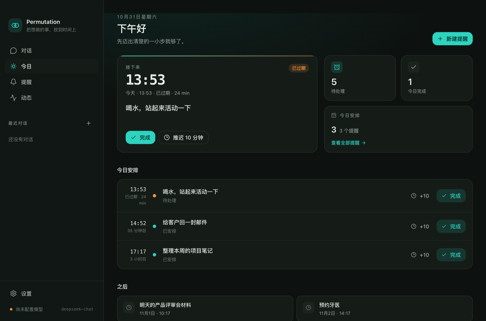

# Permutation

> 把想做的事，放到时间上。
> A calm desktop assistant that turns intentions into scheduled action.

Permutation 是一个本地优先的桌面 AI 个人助理。第一阶段专注把「一句话 → 提醒 → 到点通知 → 完成/推迟」这条闭环做扎实：聊天窗口、Agent 工具循环、持久化提醒、系统通知、托盘常驻、全局快捷键和设置页都已可用。



## 当前进度

**阶段 1（提醒 MVP）已完成。** 详见 [验收记录](docs/acceptance-phase-1.md) 与 [路线图](docs/roadmap.md)。

| 已交付       | 说明                                                            |
| ------------ | --------------------------------------------------------------- |
| 自然语言提醒 | 「十分钟后提醒我喝水」「明天下午三点提醒我交报告」              |
| 一次性提醒   | 任意时刻；重复提醒属于 P1，暂未实现                             |
| 到点通知     | 系统通知 + 应用内提醒卡片，按钮：完成 / 推迟 10 分钟 / 忽略     |
| 提醒管理     | 列表、编辑、取消（取消需确认）、完成、推迟                      |
| 持久化调度   | SQLite 存储；重启后补发错过的提醒                               |
| Agent 主循环 | 工具调用、最大步数保护、失败回传模型、禁止假装成功              |
| 双模型协议   | OpenAI 兼容（DeepSeek / OpenRouter / 中转站等）+ Anthropic 原生 |
| 本地密钥     | API Key 使用 macOS 系统钥匙串加密，不回传前端                   |
| 主动与追溯   | 托盘、`⌘⇧Space` 全局快捷键、操作日志、中英双语、深浅色          |

> 日历、邮件、语音、记忆属于后续阶段，当前版本**没有**接入。

## 快速开始

环境：macOS（当前只在 macOS 上验证）、Node.js ≥ 22.12（推荐 24）、npm 11。

```bash
npm install
npm run dev
```

`npm install` 会下载 Electron、为 Electron ABI 重新编译 `better-sqlite3`。如果 Electron 下载失败（中国大陆网络常见），设置镜像后重试：

```bash
ELECTRON_MIRROR=https://npmmirror.com/mirrors/electron/ npm run setup
npm run dev
```

首次启动后：

1. 打开 **Settings / 设置**。
2. 选择协议（OpenAI 兼容或 Anthropic），填写 Base URL、模型 ID、API Key。
3. 点 **Test connection** 验证。
4. 保存后回到 **Chat**，输入「十分钟后提醒我喝水」。

全局快捷键 `⌘⇧Space` 随时呼出窗口并聚焦输入框；关闭窗口会隐藏到托盘，应用继续计时。

## 可以这样用

- 十分钟后提醒我喝水
- 明天下午三点提醒我交报告
- 我有哪些待处理提醒？
- 把「交报告」改到明天上午十点
- 取消「交报告」的提醒 → 应用会弹出确认卡片
- 我今天完成了什么？→ 当前版本会列出提醒状态，不会编造数据

所有时间由模型先调用 `get_current_time`，再以带时区偏移的 ISO 8601 传给工具；模型不能直接写数据库。

## 架构一览

```text
React renderer（无系统权限）
        │ typed IPC via sandboxed preload
Electron main
  ├─ Agent Core：上下文 → LLM → tool calls → 结果回传 → 最终回复
  ├─ Tools：create_reminder / list / update / cancel / complete / snooze / notify
  ├─ Scheduler：15s tick + 启动补发（SQLite 持久化）
  ├─ Connectors：系统通知（日历/邮件为后续阶段）
  └─ SQLite：提醒、对话、消息、操作日志、设置、密钥密文
        │
   OpenAI-compatible / Anthropic provider
```

| 路径                        | 职责                                    |
| --------------------------- | --------------------------------------- |
| `apps/desktop/src/main`     | 窗口、托盘、IPC、调度、通知、设置       |
| `apps/desktop/src/preload`  | `contextBridge` 类型化 API              |
| `apps/desktop/src/renderer` | React + Zustand + Tailwind 界面         |
| `packages/agent`            | Provider 适配器、系统提示词、Agent 循环 |
| `packages/tools`            | 工具 Schema、确认策略、执行与日志       |
| `packages/scheduler`        | 到期检查与启动补发                      |
| `packages/db`               | SQLite schema、迁移、数据访问           |
| `packages/shared`           | 类型、时间工具、IPC 契约                |
| `packages/connectors`       | 外部系统连接器边界（阶段 2/4）          |

深入阅读：[架构说明](docs/architecture.md) · [工具清单](docs/tools.md) · [提示词版本](docs/prompts.md) · [ADR](docs/adr/README.md)。

## 常用命令

| 命令                                               | 作用                                       |
| -------------------------------------------------- | ------------------------------------------ |
| `npm run dev`                                      | 启动 Electron + Vite 开发环境              |
| `npm run build`                                    | 构建 main / preload / renderer             |
| `npm run typecheck`                                | 两套 tsconfig（Node 与 Web）类型检查       |
| `npm run verify`                                   | typecheck + test + lint + format 全部检查  |
| `npm test`                                         | Vitest 单元与集成测试                      |
| `npm run lint`                                     | ESLint                                     |
| `npm run format`                                   | Prettier 格式化                            |
| `npm run rebuild:native`                           | 重新编译 better-sqlite3                    |
| `npm run dist`                                     | 生成 macOS dmg（配置已预留，未做签名验证） |
| `npm run verify:notification`                      | 单独验证系统通知与按钮                     |
| `LLM_API_KEY=... LLM_MODEL=... npm run verify:llm` | 验证模型连接与 tool use 基础通路           |

视觉 QA（无需屏幕录制权限）：

```bash
PERMUTATION_CAPTURE_PATH=/tmp/chat.png npm run dev
PERMUTATION_CAPTURE_PATH=/tmp/today.png PERMUTATION_CAPTURE_PAGE=today npm run dev
```

`scripts/seed-demo.ts` 可以给临时数据库灌入演示数据；`scripts/mock-llm.mjs` 提供本地 OpenAI 兼容 mock，用于端到端冒烟测试。

## 数据与隐私

- 数据目录：`~/Library/Application Support/Permutation/permutation.db`（设置页可打开）。
- API Key 使用 Electron `safeStorage`（macOS 钥匙串）加密后存入 SQLite；渲染进程永远拿不到明文。
- 只有生成回复所需的对话内容会发送到你配置的模型 API；邮件和日历尚未接入。
- 每个工具调用（参数、结果、是否经确认、耗时）写入 `action_logs`，可在 **Activity** 页查看。
- 开发模式下可以用 `PERMUTATION_API_KEY` 环境变量临时提供密钥；打包版本忽略该变量。

## 测试与质量

当前自动化结果：**35 个测试通过**，覆盖时间边界、提醒仓储、工具 Schema/确认策略、调度补发、Agent 循环、两种 Provider 的请求/响应与工具转换。类型检查、生产构建与 mock LLM 端到端冒烟测试均已执行。详细记录见 [阶段 1 验收](docs/acceptance-phase-1.md)。

## 已知限制

- 仅验证 macOS；Windows 集成尚未实现。
- 提醒、日历、邮件、语音识别、记忆、每日简报尚未进入当前阶段。
- 通知按钮在 macOS 上需要展开通知才能看到；应用内提醒卡片始终提供同样按钮。
- 调度器每 15 秒检查一次，因此提醒最多晚约 15 秒；应用必须运行（或重新打开后补发）。
- 未签名的开发构建可能被 macOS 拒绝 Electron 通知；此时自动降级为 AppleScript 通知（无按钮），应用内卡片始终可完成/推迟/忽略。
- 模型回复目前非流式；工具执行过程通过事件实时显示。
- `npm run dist` 的 dmg 配置已预留，但签名、公证、图标适配和真实打包尚未纳入验收。

## 文档索引

- [架构](docs/architecture.md)
- [路线图](docs/roadmap.md)
- [阶段 1 验收](docs/acceptance-phase-1.md)
- [工具定义](docs/tools.md)
- [提示词版本记录](docs/prompts.md)
- [设计系统](docs/design-system.md)
- [架构决策记录（ADR）](docs/adr/README.md)
- [给开发 Agent 的操作手册](AGENT.md)

## License

Apache-2.0，见 [LICENSE](LICENSE)。
