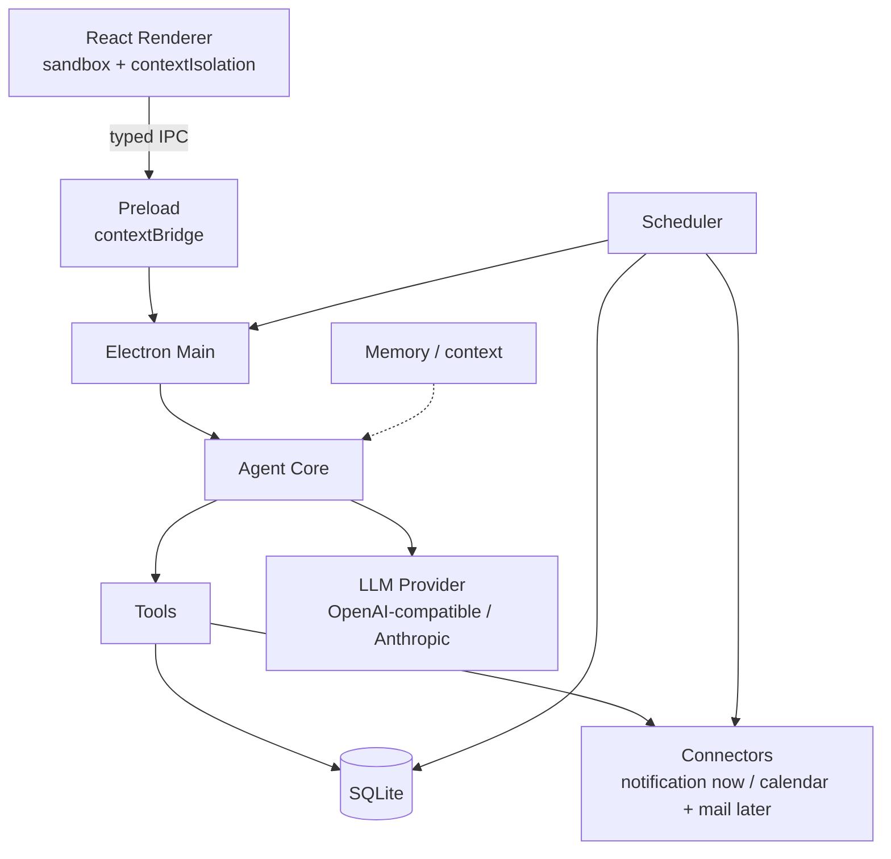
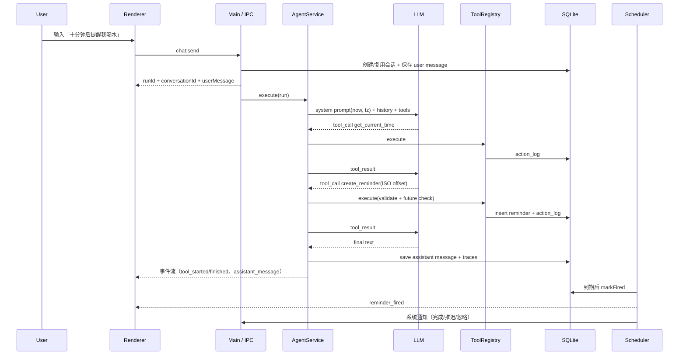
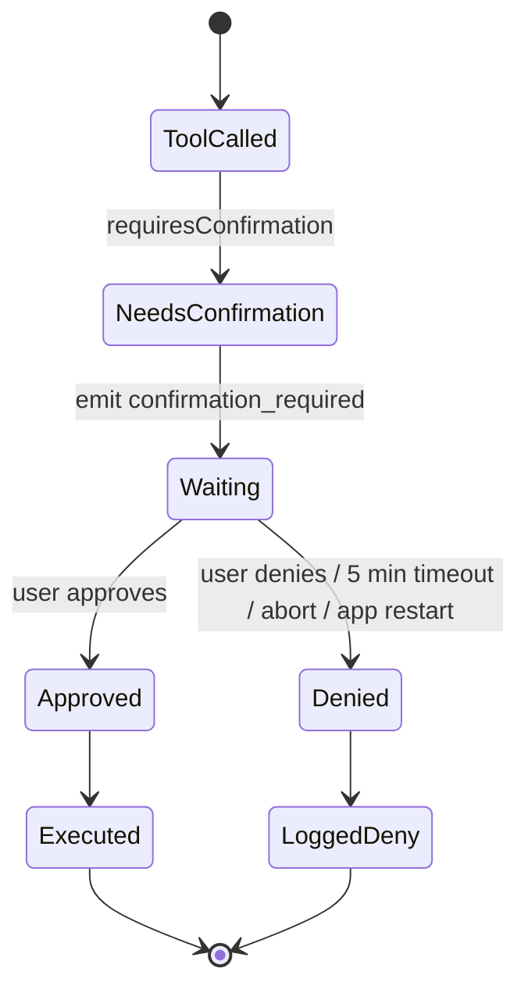

# 架构说明

## 1. 总览

Permutation 是四层 + 两个横切模块的结构：



- **界面层**：只展示与输入，不直接接触 Node、文件系统或网络。所有能力通过 `window.permutation`。
- **编排层**：Agent loop，构造上下文、调用模型、执行工具、把结果回传模型，直到最终文本。
- **工具层**：每个能力一个 Schema + 实现 + 确认策略 + 日志。
- **集成层**：系统通知已实现；日历/邮件在 `packages/connectors` 预留边界。
- **调度器**：基于 SQLite 的到期检查与启动补发。
- **记忆**：阶段 1 只注入最近对话与工具摘要；长期记忆表已预留，尚未启用。

## 2. 进程与安全边界

| 进程     | 能做什么                                         | 不能做什么                                              |
| -------- | ------------------------------------------------ | ------------------------------------------------------- |
| Renderer | React 状态、渲染、通过 preload 调用 IPC          | 访问 `fs`、`child_process`、Electron 模块、直接请求模型 |
| Preload  | 暴露类型化、白名单 IPC                           | 业务逻辑、持久化、密钥读取                              |
| Main     | 窗口、托盘、SQLite、钥匙串、网络请求、通知、调度 | 信任 renderer 传入的任意路径/命令                       |

浏览器窗口配置：

- `sandbox: true`
- `contextIsolation: true`
- `nodeIntegration: false`
- 外部链接由 `setWindowOpenHandler` 交给系统浏览器
- `index.html` 设置 CSP；开发模式允许 Vite HMR 的 `ws:` 与 worker blob

## 3. 目录

```text
apps/desktop/
  src/main/        index, window, tray, menu, ipc, settings, notifier,
                   agent-service, reminder-service, capture(QA)
  src/preload/     contextBridge API
  src/renderer/    React app, pages, components, store, i18n, styles
  electron.vite.config.ts
  electron-builder.yml
packages/
  shared/          types, time, ids, IPC contracts, constants
  db/              migrations + repositories
  agent/           providers (openai, anthropic), prompt, runner
  tools/           registry + 8 tools
  scheduler/       tick + catch-up
  connectors/      interface boundary + future calendar/mail
scripts/           verify, seed, mock LLM, API key seeding
tests/             vitest unit/integration
```

工作区包以源码形式通过 Vite alias 引用，不单独产出 dist；这样开发/测试只有一个事实来源。

## 4. 一次对话的完整链路



事件通过 `permutation:event`（`EVENT_CHANNEL`）广播给所有窗口。渲染进程的 Zustand store 统一消费事件，避免页面之间各自订阅。

## 5. Agent Core

### 5.1 Provider 抽象

```ts
interface LLMProvider {
  chat(request: LLMChatRequest): Promise<LLMChatResponse>
  ping(): Promise<{ text: string; latencyMs: number }>
}
```

- **OpenAI-compatible**：`POST {base}/chat/completions`；支持 `tools` / `tool_calls` / `tool` 消息。
- **Anthropic**：`POST {base}/v1/messages`；把内部消息转换为 `tool_use` / `tool_result` content blocks，并合并连续 tool result。
- Base URL 解析同时支持「带 /v1」和「不带 /v1」的写法。
- 120 秒请求超时；用户取消通过 `AbortController` 传播。
- 非流式：一次响应结束后再广播完整消息。工具过程仍然实时可见。

### 5.2 循环与保护

1. 系统提示词注入当前时间、时区、星期、locale、语言。
2. 历史消息最近 24 条；历史 assistant 消息附带工具摘要，便于「刚才那个」类跟进。
3. 模型返回 tool calls → 逐个执行 → 结果作为 `tool` 消息回传。
4. 最多 `maxAgentSteps`（默认 8）步；超限抛 `max_steps`，广播 `run_failed`。
5. 工具错误作为 `{ok:false,error}` 回传，模型可以换办法或如实告知。
6. 取消时 `AbortController` 终止请求；待确认操作一律视为拒绝。

### 5.3 工具注册表

`ToolRegistry` 同时承担：

- 生成 JSON Schema（Zod → JSON Schema，去掉 `$schema`）
- 参数校验（`safeParse`）
- 确认策略判定
- 执行、耗时统计、`action_logs` 写入
- 未知工具与异常统一转成错误结果，不抛出到模型之外

## 6. 确认机制



- 确认状态只保存在主进程内存（`AgentService.runs[].confirmations`）。
- 超时、取消、崩溃、重启都会让确认自然失效——**失败关闭**。
- 拒绝也执行一次占位（`status: denied`），写入日志，并告诉模型「用户拒绝，不要重试」。
- 当前高风险工具：`cancel_reminder`。阶段 2 起：日历修改/删除、发送邮件。

## 7. 调度器

- 基于 SQLite `reminders(status, trigger_at)` 索引，每 15 秒 tick。
- 每次 tick：`status='pending' AND trigger_at <= now` → `markFired` → 回调。
- 启动时 `catchUp()` 把停服期间到期的提醒标记为 fired，并带上 `missed: true`。
- 休眠/解锁：`powerMonitor.resume` / `unlock-screen` 立即 `checkNow()`。
- 一次性提醒；推迟会重置 `pending` 与新的 `trigger_at`。
- 单进程内用 `running` 标记避免重叠 tick；`onDue` 失败会记录但不阻塞后续。
- 系统通知优先走 Electron；若 macOS 拒绝（常见于未签名构建），降级为 AppleScript 通知，应用内卡片始终可操作。

为什么不用 `node-schedule`：提醒必须可重启恢复，数据库才是事实来源；tick 足够简单且可测试。

## 8. 数据模型

| 表                  | 关键字段                                                                                   | 说明                                                         |
| ------------------- | ------------------------------------------------------------------------------------------ | ------------------------------------------------------------ |
| `reminders`         | id, content, trigger_at, status, source, conversation_id, fired_at, created_at, updated_at | UTC ISO；status: pending/fired/completed/dismissed/cancelled |
| `conversations`     | id, title, created_at, updated_at                                                          | 最近对话排序                                                 |
| `messages`          | id, conversation_id, role, content, tools_json, created_at                                 | 只存 user/assistant；工具轨迹以 JSON 保存                    |
| `action_logs`       | tool_name, args_json, result_json, status, confirmed, duration_ms, source                  | 可追溯每个动作                                               |
| `settings`          | key, value, updated_at                                                                     | `app_settings` 为 JSON                                       |
| `secrets`           | key, value(BLOB), updated_at                                                               | safeStorage 密文                                             |
| `memories`          | key, content, source                                                                       | 阶段 5 预留，暂未使用                                        |
| `schema_migrations` | version, name, applied_at                                                                  | 只追加迁移                                                   |

路径：`app.getPath('userData')/permutation.db`。WAL + foreign_keys + busy_timeout。

## 9. 设置与密钥

- 非敏感设置以单个 JSON 存 `settings.app_settings`。
- API Key 通过 `safeStorage.encryptString` 写入 `secrets.llm_api_key`；读取时解密，**从不发给 renderer**。
- 前端只拿到 `hasApiKey: boolean`。
- 系统钥匙串不可用时不退化为明文，直接报错。
- 未打包开发模式允许 `PERMUTATION_API_KEY` 环境变量，便于 CI/E2E；打包版忽略。

## 10. Renderer

- Zustand 单 store：bootstrap、settings、reminders、conversations、messages、active runs、confirmation、fired queue、toast。
- chat run 按 `conversationId` 存储，切换会话时后台运行状态不丢。
- 主题：设置优先，`system` 时监听 `prefers-color-scheme`；主进程同时设置 `nativeTheme.themeSource`。
- i18n：纯函数字典 `zh/en`；语言由设置或系统 locale 决定。
- 页面：Chat / Today / Reminders / Activity / Settings；托盘 + 应用内提醒卡片 + Toast。

## 11. 测试策略

| 层       | 方式                                                                           |
| -------- | ------------------------------------------------------------------------------ |
| 时间     | 无时区拒绝、UTC 归一、偏移格式化                                               |
| DB       | 内存 SQLite + 迁移幂等 + 仓储行为                                              |
| 工具     | Schema、校验失败、确认拒绝/通过、日志                                          |
| 调度     | 到点一次、启动补发、推迟、回调失败                                             |
| Agent    | 工具循环、时间注入、历史摘要、确认、超限、Provider 错误                        |
| Provider | mock fetch 校验 URL/headers/body，Anthropic 块转换                             |
| E2E 冒烟 | 本地 mock LLM + Electron + 真实 SQLite；验证创建、落库、到点 fired、应用内卡片 |

视觉 QA 使用 `capturePage` 钩子，不依赖 macOS 屏幕录制权限；详见 [验收记录](acceptance-phase-1.md)。

## 12. 后续阶段接入点

- 日历：`packages/connectors` 定义 `CalendarConnector`；主进程实现 EventKit helper（Swift 子进程）；工具层新增 `list_events` 等。
- 邮件：IMAP 连接器在主进程运行；工具只接收摘要/片段，避免把整封邮件塞进上下文。
- 记忆：启用 `memories` 表；在 `buildSystemPrompt` 前按需注入，提供查看/删除 UI。
- 语音：renderer 采集音频 → 主进程/本地模型转写 → 复用 chat pipeline。
- 内置日历：若选择，需要新的 `calendar_events` 表 + UI，并明确与 Apple Calendar 的同步方向。
