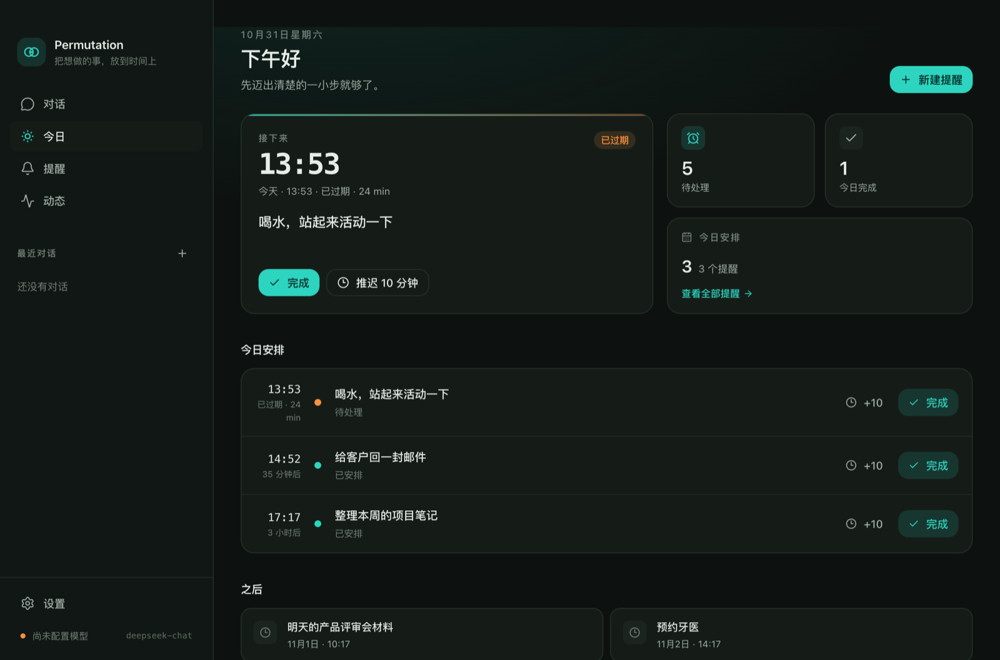
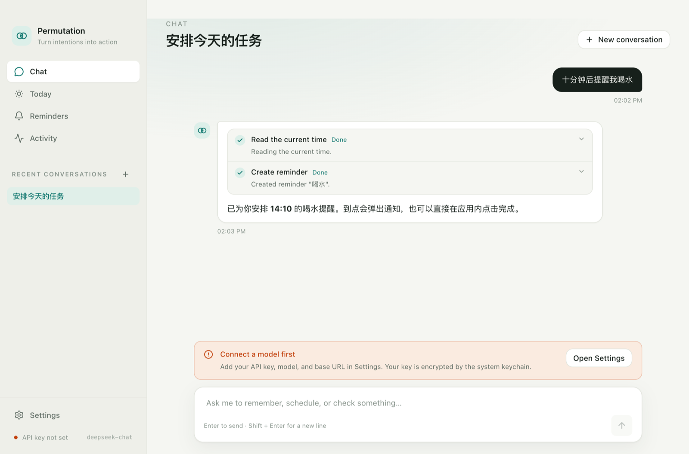
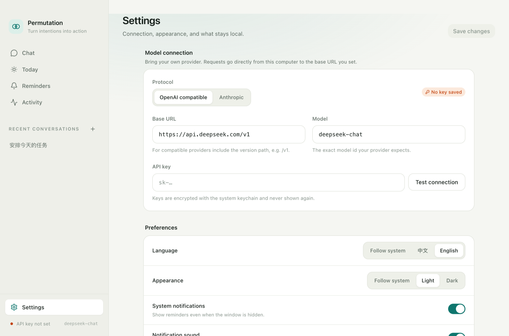
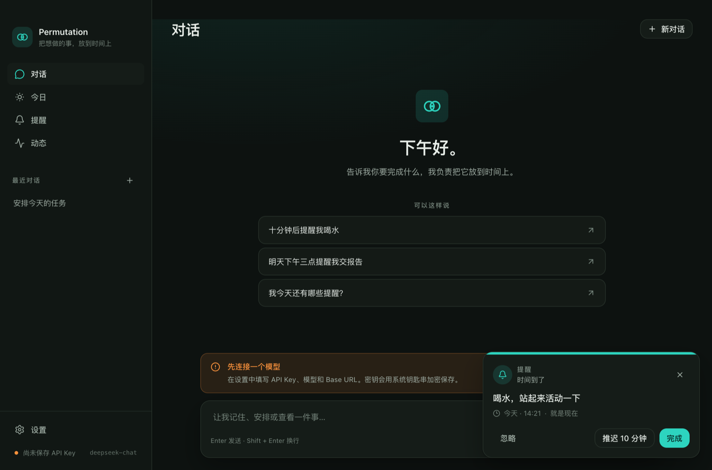

# 设计系统

Permutation 的界面目标是：**安静、可信任、有推动力，但不制造焦虑**。它不是一个数据仪表盘，也不是一个聊天玩具；它更像一张放在桌面上的时间纸，提醒你下一步做什么。

设计系统在执行时参考了 `ui-ux-pro-max` 的检索结果（微交互、单一列、teal + warm accent），但**没有采用**其建议的 Caveat / Quicksand 字体：这两种字体不适合中英混排、小字号信息密度和桌面生产力工具。最终方案使用系统 UI 字体与可读性更高的配色。

## 1. 设计原则

1. **一句话，一个动作**：每个页面只有一个主要行动（创建提醒 / 完成 / 开始对话）。
2. **时间优先**：时间用等宽数字、足够大；相对时间帮助判断紧迫性。
3. **安静的通知**：提醒使用 accent 或 warm，不使用大面积红色。
4. **可追溯**：每个自动动作都能在 Activity 中查到，确认状态可见。
5. **双语同权**：中文与英文使用同一套布局、字号、间距；不做「中文特供」压缩。
6. **无 emoji 图标**：统一 Lucide SVG。

## 2. 颜色

语义 token 定义在 `apps/desktop/src/renderer/src/styles.css`。

### Light

| Token             | Value     | 用途                               |
| ----------------- | --------- | ---------------------------------- |
| `--c-bg`          | `#F5F6F2` | 页面底色（暖白）                   |
| `--c-surface`     | `#FFFFFF` | 卡片、输入框                       |
| `--c-surface-2`   | `#EEF0E9` | 次级底、分组                       |
| `--c-sidebar`     | `#EEEFE9` | 侧栏                               |
| `--c-ink`         | `#17201B` | 主文字                             |
| `--c-muted`       | `#5E6B63` | 次级文字                           |
| `--c-faint`       | `#6B7870` | 提示文字（已加深以满足小字号对比） |
| `--c-line`        | `#E1E4DC` | 边框                               |
| `--c-accent`      | `#0F766E` | 主色 / 主要按钮                    |
| `--c-accent-soft` | `#DCEFE9` | 主色浅底                           |
| `--c-warm`        | `#C2410C` | 逾期、待确认                       |
| `--c-danger`      | `#B42318` | 失败、删除                         |

### Dark

| Token             | Value                   |
| ----------------- | ----------------------- |
| `--c-bg`          | `#0D1210`               |
| `--c-surface`     | `#151C18`               |
| `--c-surface-2`   | `#1B241F`               |
| `--c-sidebar`     | `#111714`               |
| `--c-ink`         | `#E7EDE8`               |
| `--c-muted`       | `#A0AEA5`               |
| `--c-faint`       | `#74837A`               |
| `--c-line`        | `#263029`               |
| `--c-accent`      | `#2DD4BF`               |
| `--c-accent-soft` | `rgba(45,212,191,0.14)` |
| `--c-warm`        | `#FB923C`               |
| `--c-danger`      | `#F97066`               |

使用规则：

- 主按钮：accent 背景 + `accent-contrast` 文字；深色模式下为浅薄荷底 + 深色文字。
- 危险动作：只在取消/删除确认中使用 `danger`，不使用纯红大按钮。
- 逾期：warm，而不是 danger；逾期不是错误。
- 状态标签：pending = accent soft；fired/overdue = warm soft；completed = neutral。

## 3. 字体与排版

- 字体：`-apple-system, BlinkMacSystemFont, "SF Pro Text", "Segoe UI", "PingFang SC", "Hiragino Sans GB", "Microsoft YaHei", "Noto Sans SC", sans-serif`
- 等宽：`SF Mono, ui-monospace, SFMono-Regular, Menlo`
- 页面标题：24px / 600 / -0.02em
- 区块标题：13px / 600
- 正文：14px / 1.55
- 次级：13px / muted
- 说明：11.5–12px / muted or faint
- 时间数字：13px mono；Next up 大时间 34px mono
- 行宽：设置页 max-w-3xl（768px）；聊天 max-w-3xl；正文尽量 < 75 字符

## 4. 间距、圆角、阴影

- 基础间距 4px；常用 8 / 12 / 16 / 20 / 24 / 32。
- 页面左右 padding 32px（`px-8`）。
- 圆角：输入/按钮 `rounded-xl`（12px），卡片 `rounded-2xl`（16px），弹窗 16px。
- 阴影：`0 1px 2px rgba(23,32,27,.04), 0 10px 30px rgba(23,32,27,.06)`；深色更深。
- 边框优先于阴影；避免「漂浮卡片森林」。

## 5. 布局

```text
┌──────────────┬────────────────────────────────────┐
│ Sidebar 252  │ drag strip 32                      │
│ brand        │ PageHeader (24px title + actions)  │
│ nav          │ content (scroll)                   │
│ recent       │                                    │
│ settings     │                                    │
│ model status │                                    │
└──────────────┴────────────────────────────────────┘
```

- 最小窗口 940×640；默认 1180×780。
- macOS `titleBarStyle: hiddenInset`，侧栏顶部预留 42px 拖拽区；主区域顶部 32px 拖拽条。
- 聊天页：消息区独立滚动，输入框固定在底部；空态垂直居中。
- 提醒弹层固定在右下角，宽度 360px，不阻塞主界面。
- Toast 固定在右上角，4.2 秒自动消失。

## 6. 组件规则

| 组件         | 规则                                                                                 |
| ------------ | ------------------------------------------------------------------------------------ |
| Button       | primary / secondary / ghost / danger / soft；高度 32 或 40；禁用时变灰而非半透明主色 |
| IconButton   | 32×32，必须有 `aria-label` + tooltip                                                 |
| Badge        | 仅表达状态，不承担按钮功能                                                           |
| Segmented    | 用于协议、语言、主题；选中项白底微阴影                                               |
| Switch       | 40×24；受控；必须有 label                                                            |
| Modal        | 遮罩 + 16px 圆角卡片；ESC 关闭；`role="dialog"`                                      |
| Tool trace   | 可展开参数；运行中转圈；成功/失败/拒绝三态图标                                       |
| Confirmation | warm 边框 + 明确摘要 + 「暂不 / 确认执行」；不默认聚焦确认                           |
| Toast        | 只用于结果反馈；不承载需要用户决策的内容                                             |

## 7. 动效

- 进入：220ms `cubic-bezier(.22,1,.36,1)`，位移 8px + 淡入。
- 颜色/背景：150ms。
- 不做布局位移式 hover（避免抖动）。
- 尊重 `prefers-reduced-motion`：动画缩短到 0.01ms。
- 打字指示器：三个 1.2s 循环点；不使用无限旋转的装饰。

## 8. 无障碍

- 正文对比度 ≥ 4.5:1；faint 已加深。
- 所有图标按钮有 `aria-label`；导航有 `aria-current`。
- 键盘：Tab 顺序自然；Modal ESC 关闭；输入框 focus ring 可见。
- 不只用颜色表达状态：状态有文字（Waiting / Overdue / Denied）。
- 时间同时给出绝对与相对表达，避免只靠「3 分钟后」。

## 9. 页面速览

| 页面             | 截图                                              |
| ---------------- | ------------------------------------------------- |
| 今日（深色）     |               |
| 对话（浅色）     |               |
| 设置（浅色）     |       |
| 提醒卡片（深色） |  |

## 10. 设计 token 源

完整 token 与覆盖规则见 [design-system/permutation/MASTER.md](../design-system/permutation/MASTER.md)。改颜色/字号前先改 token，不要在组件里散落 hex。
